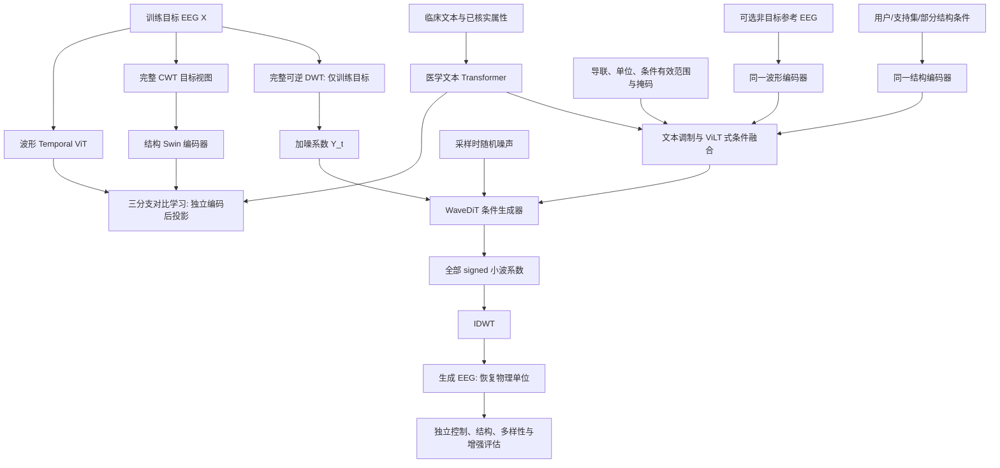

# 历史设计：TriWave-EEG v0.1

本文件保留旧三分支设计以便追溯，已由 [当前双分支架构](architecture.md) 取代，不是后续实现要求。

# TriWave-EEG 模型架构 v0.1

状态：研究设计，2026-10-07。尚未实现或测试。尺寸和超参数是起步配置，不能作为最优设置或硬件实测结果。

## 1. 目标、边界与设计选择

首篇研究临床事件条件生成及患者独立的少样本增强。长期目标是跨临床队列、导联配置和任务迁移；首版不能据此宣称泛化到所有 EEG。

拟检验的主张：先测结构条件相对粗类别条件的信息收益，再在相同真实数据与相同属性输入下检验临床文本、部分小波结构和可选参考 EEG 的融合架构，能否提高控制精度，同时保留个体变化，并改善独立真实记录上的检测。

确定保留三分支及显式小波条件扩散。生成空间、概率路径和融合复杂度分别验证，不将增加模块数量当成创新。

| 设计轴 | v0.1 候选主路径 | 必要对照/后续 |
|---|---|---|
| 表示分支 | 波形 Temporal ViT、数值 CWT 小型 Swin、临床文本 Transformer | 三分支保留；逐项关闭辅助对齐测量贡献 |
| 融合 | 文本调制结构特征＋轻量 ViLT 式 condition-token Transformer | 简单拼接、相同属性数值 FiLM、MMDiT 式双流 |
| 生成空间 | 完整 signed DWT 系数，经 IDWT 输出波形 | 相同条件和预算的原始波形空间 |
| 概率路径 | DDPM v-prediction 条件扩散 | 同骨干 conditional flow matching，与 JET 对照 |
| 生成骨干 | 小型 WaveDiT；时序/导联/尺度身份明确 | JET 原始波形骨干、MPDiT 式粗到细 patch |
| 压缩 | 无有损 VAE；patchification 不删除信号标量 | VAE 仅在事件重建通过后进入候选 |
| 加速 | 先验证 30/50/100 个采样步的质量—成本关系 | 后续少步蒸馏/MeanFlow/对抗加速 |

JET 已在临床 EEG 上使用 Transformer、类别条件 flow matching 及结构约束，是强基线和主干参考。普通条件扩散仍为首版明确实现路径；CFM 是独立目标和采样方案，不能称为同一个 DDPM 目标。[JET](https://arxiv.org/abs/2605.21280)、[DiT](https://arxiv.org/abs/2212.09748)、[SiT](https://arxiv.org/abs/2401.08740)

## 2. 总体信息流

训练目标路径和外部条件路径必须在实现中分开。完整目标波形编码与完整目标 CWT 用于表示学习/监督，不进入 externally-conditioned 生成器的条件融合。

## 3. 数据与张量契约

### 3.1 波形

起步配置：`X ∈ R[B, C=16, L=1024]`，256 Hz，4 秒，单位 µV。使用经核实的 16 条标准双极导联交集。TUH 若具备可用共参考单电极信号，可计算相应电极差；CHB-MIT 按导联名称和极性匹配已有双极信号。不能把双极信号无依据地反演成单电极电位。

16 条导联候选为左右颞侧链和旁矢状链：Fp1–F7–T7–P7–O1、Fp1–F3–C3–P3–O1、Fp2–F8–T8–P8–O2、Fp2–F4–C4–P4–O2。实际可用性必须由文件检查确认；缺失时使用掩码或独立协议，不能填成真实测量。

4 秒是算力原型，不足以表达所有完整发作。条件的起止、覆盖时间必须解释为窗口内区间，并记录事件是否被截断。后续扩展到 8/16 秒；不把 4 秒结果外推为长时完整发作生成。

所有源采样率、参考、通道极性、单位和已存在滤波保留。目标频率覆盖由源设备和任务确定，不能统一声称恢复不可观测频率。归一化使用训练集拟合的全局物理尺度，初版不采用逐窗口 z-score，也不按 DWT 子带分别白化。raw/DWT 比较使用相同波形尺度。

### 3.2 数值结构视图

`S_full ∈ R[B, C, F=64, T_s=128]` 为数值 log-power CWT。先计算线性 power，做带有效掩码的时间汇总，再取 `log(ε+Pool(power))`；粗频带能量控制和物理评价在线性功率域定义。不能把平均 log-power 解释为算术平均能量。频率采用对数坐标，原型覆盖约 2–80 Hz，实际有效范围由源数据和滤波决定。它是控制视图的范围，不是生成信号所有频率的范围。支持集CWT/连续滤波的全部上下文必须属于允许支持记录，不能越过保护区读取查询。

CWT 在带上下文的原始连续区间计算后裁剪目标窗口，保存 cone-of-influence/有效区域掩码。低频需要更长上下文；没有足够上下文时禁用相应边界监督，不能把补零伪影当结构。生成估计通常只有4秒，不能沿用带外部上下文的真实CWT有效区域：生成结构损失需使用双方共同有效的内部区域，或用同一有限窗口变换重算目标/生成视图并排除共同边界。母小波、频率、采样率、时间坐标、功率定义与变换版本必须入元数据。

`S_cond` 与 `S_full` 同接口，但前者是外部或部分条件。包括值、观测掩码、时间范围和条件角色。缺失位置可置零输入，但必须带 mask，零不能同时表示真实低能量与缺失。

主训练与测试条件可以是粗频带包络、事件时间区间、导联活动范围或参考样本的部分结构。训练中 desired-attribute 条件可以从训练目标提取低维/粗结构注释，并明确标记 target-derived label；observed-reference 条件必须来自独立支持样本。粗化、遮挡、扰动只用于模拟声明的推理输入，完整目标视图不进入外部条件融合。外部条件生成与增强主评估禁止从锁定查询目标提取任何结构条件，包括粗化或遮挡版本。真实目标的部分观测仅属于另列的 reconstruction/inpainting 协议。

结构patchification、patch merging与readout必须传播有效mask和有效比例，不能把缺失零填充计入功率均值。若波形存在无效时间区，DWT系数有效性按滤波器支持范围传播，不直接复制原波形mask。完全缺失的模态保留一个可见null token，避免全mask注意力行；条件来源编码表示用户/支持/标注等角色，患者、医院、数据集ID仅用于审计，不输入主模型作语义捷径。

### 3.3 文本与数值属性

`T_tokens ∈ N[B, <=64]` 是短事件描述；真实长报告另设记录级聚合协议。模板来源、否定、置信度、时间范围和患者/记录/窗口粒度随样本保存。

连续属性如窗口内覆盖起止、频带能量范围以单独数值 token 表达，文本说明其含义。它们不是靠 BERT 精确理解数字完成控制。输出评估单位与条件一致。

首版以英语标注模板匹配源数据；中文界面/自由中文提示不作为当前已具备能力。模板生成不添加源标注没有提供的诊断、严重程度或病灶信息。

## 4. 三分支表示模型

### 4.1 波形分支：Temporal–Lead ViT

将每条导联按 32 个样本分 patch：`[B,16,1024] → [B,16,32,32] → [B,16,32,256]`，总 512 个 token。32 样本为 125 ms；patch 内所有值进入投影，并非平均掉短暂事件。

建议 6 个轴向 Transformer block，维度 256，8 heads，MLP ratio 4。交替执行每条导联内的时间注意力与同一时间位置的导联注意力。使用实际物理时间位置、正负电极端点/极性、导联参考类型及有效掩码。导联图偏置可表达共享端点和距离；它不是脑网络连接真值。

支路输出：

- 全局池化向量，经 256 维投影头做对比学习。
- 参考条件时保留每导联 4 个时间摘要 token，共 64 个。
- 可选局部 token 用于表征预训练；初版不把全部 512 个参考 token 放入融合器。

原型采用双向注意力，因为离线生成不是在线预测。若后续声称在线检测，需要单独因果协议，不能继承当前结论。

### 4.2 结构视图分支：小型 Swin

对每条导联的 `[64,128]` 数值频率—时间平面使用共享的轻量 Swin 编码器。初始 patch 为 `[4 frequencies,8 time bins]`，每导联得到 `16×16=256` 个局部 token。候选 stage 宽度 `64/128/256`，深度 `2/2/2`，局部窗口注意力与 shifted window、层级 patch merging。

这里 Swin 的二维轴是频率和时间。频率位置使用实际 Hz/log-Hz 编码；导联空间关系由导联注意力处理，不能把导联任意排版成图像邻接。禁止将任意频率平移、水平翻转当作无害图像增强。

各 stage 通过有物理坐标的 readout 汇总每导联 `2 frequency summaries×4 time summaries=8` 个 token，共 128 个；另保留 16 个导联全局 token，总 144。摘要的“2 个频率组”只是 token budget，不等同于仅保留两种频带，编码器先观察全部有效频率。

全局投影头用于 EEG–结构、文本–结构对比学习；层级特征用于多尺度条件注入。需要更细时序控制时增加时间摘要或事件坐标 token，并重新测量显存与控制误差。4 个时间摘要不能直接宣称提供亚秒结构定位。

### 4.3 临床文本分支

候选使用冻结的 Bio_ClinicalBERT/ClinicalBERT 类编码器，输出 `[B,N_T,768]`，投影到 256。具体 checkpoint、许可证、分词方式在实施前核实。起步冻结文本主干，仅训练投影/适配器；对比通用 BERT 和直接类别/属性 embedding，检验医学预训练是否有贡献。

独立文本池化投影用于对比学习。事件码、数值属性、否定与适用范围保留为可检验的结构化条件，而不只拼进长句子。

真实报告如实际取得：先分 history/description/impression 等角色，再以记录级片段集合聚合或 MIL 与文本对齐。禁止把患者病史作为每个窗口的事件真值。[EEG-CLIP](https://www.frontiersin.org/journals/robotics-and-ai/articles/10.3389/frobt.2025.1625731/full)、[ELM](https://proceedings.mlr.press/v267/gijsen25a.html)

### 4.4 三分支对比目标

独立编码得到 `z_E,z_S,z_T` 后，按有效配对关系计算 `L_ES + L_ET + L_ST`，采用多正例和关系掩码。所有对比投影均在融合前计算，结构投影不能先读同一句文本再用文本相似度证明对齐。

同类别模板不等于同一个 EEG 实例；语义正例组与实例关系分开。重叠窗口、同一报告复制文本及相同模板不能简单当作 batch 内强负例。不同病理状态之间的 hard negative 也应控制数据来源/年龄/设备混杂。

语义投影不承担全部生成细节；编码器保留局部特征和可选自监督重建任务，避免把同标签 EEG 压成同一波形表示。目标 clean EEG 的对齐向量只用于表示阶段/辅助监督，不能喂给条件生成器。

## 5. 条件融合：ViLT 思想＋文本调制

借鉴 ViLT 的统一 token 接口与轻量多模态交互，不复制自然图像模型的全部特征抽取或预训练任务。[ViLT](https://proceedings.mlr.press/v139/kim21k.html)

最大参考配置：64 个参考 EEG token＋144 个结构 token＋64 个文本 token＋约 8 个 metadata/事件 token，总约 280。缺失模态使用 role/null token 与 attention mask，不生成虚构配对。

流程：

1. 各支路映射到 256 维，添加 modality、role、物理坐标及来源/置信度编码。
2. pooled 文本驱动 bounded FiLM，调制结构层级特征。采用 near-identity 初始化，防止语义覆盖观测结构。
3. 3 层、宽度 256、8 heads 的融合 Transformer 对有效 condition tokens 做自注意力。condition dropout同步作用于所有支路通道：文本drop必须同时替换FiLM pooled文本、全局向量与文本tokens；不能只mask一个融合输入。
4. 输出全局条件向量 `g` 与局部 condition tokens `K`。`g` 调制生成器 adaLN，`K` 通过 cross-attention 保留局部条件。
5. 多尺度结构 readout 依次注入浅/中/深层；每层只使用选定 scale bank，不无上限堆叠所有分辨率 token。

文本调制与局部/全局融合受到 Sketch2CT 的 TSFE/CGFM 启发；多尺度条件注入受到 MSADN 的 MSGG 启发。它们在 EEG 中的收益是待验证机制，而非已被证明的生理保证。[Sketch2CT](https://openaccess.thecvf.com/content/CVPR2026/html/An_Sketch2CT_Multimodal_Diffusion_for_Structure-Aware_3D_Medical_Volume_Generation_CVPR_2026_paper.html)、[MSADN](https://www.nature.com/articles/s41598-025-96185-2)

首版只借鉴 MMDiT 的模态身份与交互思想。模态专属参数的完整双流版本是融合消融；不同时堆叠 ViLT、MMDiT 和另一套融合网络。[SD3/MMDiT](https://arxiv.org/abs/2403.03206)

## 6. 小波条件生成器

### 6.1 可逆 DWT 与候选生成空间

初始候选使用 3 级一维 db4 DWT、`periodization` extension。对 `L=1024`，各完整 signed 系数长度为：

| 子带 | 长度/导联 | patch=32 的 token 数/导联 | patch 近似物理时间跨度 |
|---|---:|---:|---:|
| A3 | 128 | 4 | 1 s |
| D3 | 128 | 4 | 1 s |
| D2 | 256 | 8 | 0.5 s |
| D1 | 512 | 16 | 0.25 s |
| 合计 | 1024 | 32 | 多尺度 |

16 导联总 512 个 token。所有子带均保留，输出 signed 系数，使用同一滤波器、边界模式与原长度做 IDWT；CWT 功率图不用于直接反演波形。

`periodization` 与 `periodic` 不是同一种 extension。上述长度依赖前者；symmetric/periodic 等模式可能改变系数长度。实施前应验证随机与临床事件波形的数值重建误差及首尾伪影。首尾环接的物理风险需与 padding/cropping 方案比较。

DWT 保留总标量数，没有凭空压缩、增加信息或保证性能。子带覆盖只具有近似频率解释，不能把 db4 子带直接当作严格 delta/theta/alpha/beta 分类。

### 6.2 WaveDiT

起步宽度 384，6 heads，12 blocks，MLP ratio 4。输入系数 patch token 添加子带、物理时间中心/支持范围、导联端点及极性编码。不同子带的第 j 个 token 不代表同一个物理时刻。

主 block 路径：

`adaLN(g, diffusion_time) → within-lead multiscale temporal attention → same-band/same-time lead attention → selected structure/text/reference cross-attention → MLP`。

跨子带采用物理时间/支持范围感知的注意力或跨尺度汇总；导联注意力在同一子带位置执行。必要的全局注意力每若干块插入作为消融，避免主路径 512-token dense attention 的不必要开销。

条件注入使用 adaLN-Zero/zero-init residual gate 的稳定初始化思想，输出线性 head unpatchify 全部系数。借鉴的是 DiT/JET 的生成骨干结构；波形支路 ViT 和生成器 WaveDiT 是不同职责，不把 clean EEG encoder 当作 diffusion input。

可逆 DWT 路径需与原波形域 JET/同尺寸 WaveDiT 比较。若 DWT 域无优势，可以保留三分支、小波条件和小波损失，将生成空间改回波形；这仍满足项目的小波条件扩散要求，但必须诚实报告空间选择结论。

### 6.3 DDPM v-prediction：首版明确的条件扩散

设归一化完整 DWT 系数为 `Y`：

`Y_t = α_t Y + σ_t ε`，`α_t²+σ_t²=1`。

网络预测 `v_t = α_t ε − σ_t Y`，基本目标为 valid coefficients 上的 masked MSE。clean 估计为 `Y_hat = α_t Y_t − σ_t v_hat`，再 IDWT 得到物理波形估计。

候选 cosine schedule；训练时完整离散噪声范围，采样比较 DDIM 的 30/50/100 步等预算。步数是计划设置，不是速度或质量承诺。CFG 使用分别可缺失的文本/结构/参考条件 dropout。montage、输出长度、采样率、单位尺度等必需表示元数据保持；病理状态、事件起止、功率目标等是可drop的期望属性条件。guidance scale 由真实验证集控制质量—多样性曲线确定。

### 6.4 条件 flow matching：现代升级对照

同一生成空间和骨干另设 `Y_s=(1−s)ε+sY`，学习向量场 `u=Y−ε`，ODE 从 `s=0` 积分到 1。采样用 Euler/Heun，按实际函数评估次数 NFE 匹配成本。不能把 20 个 Heun steps 与 20 个 Euler NFEs 直接当相同预算。

DDPM 的 v-target 与 CFM vector-field target 不同，训练目标/噪声时间/调度器分别记录。CFM 借鉴 JET/SiT；可后续比较 JiT 式 clean-data prediction，但需一致定义其向量场换算、端点稳定性与时间权重。

生成时间 `t` 或 `s` 是噪声/运输参数；波形物理时间 `τ` 是 EEG 的样本时间。连续生成路径不是已经证明的神经动力学机制。[JiT](https://arxiv.org/abs/2511.13720)

## 7. 三种推理协议

| 模式 | 可用输入 | 要证明的能力 |
|---|---|---|
| 文本/属性生成 | 临床文本与用户指定属性；结构/参考可缺失 | 学习条件分布，不能宣称患者个体化已成立 |
| 文本＋部分结构 | 用户草图/期望频带包络/支持集结构＋文本 | 结构编辑与条件一致性 |
| 支持集参考生成 | 独立、允许的少量参考 EEG＋文本＋可选结构 | 患者适配增强；必须报告支持样本预算 |

真实参考 EEG 是允许的条件，但不必每次存在。它必须与目标/锁定查询集不同，排除重叠窗口和同一事件泄漏；support protocol 与 strict zero-target-data protocol 分别报告。

纯文本模式不会用 LLM 编造一张称为真实生理证据的结构图。可选后续结构规划器为 `text → coarse structure distribution → EEG`，这是 Sketch2CT 两阶段思想的进一步迁移，需要独立训练、额外成本与直接生成对照；首版不默认启用。

完整目标结构输入只属于明确的 reconstruction/inpainting 协议。其结果不混入外部条件生成或新增独立增强样本的主结果。

## 8. 训练顺序与损失

### 阶段 A：三分支表征学习

用源训练集真实波形、其结构视图及有依据的文本进行多正例对比学习。可选 masked EEG/CWT reconstruction 防止忽略低能量局部结构。冻结医学文本主干，训练 wave/structure 编码器与投影。

### 阶段 B：条件生成

复用阶段 A 的条件编码器，初期冻结或使用低学习率。只把合法参考/部分结构/文本作为条件。目标波形编码与 full CWT 是监督。训练采用与推理缺失模式一致的 condition dropout，并对罕见事件进行采样控制，同时保留 patient/event provenance。

默认优先基本 generative loss；辅助项逐项加入：

- `L_wavelet`：重建估计的 signed DWT 细节或分尺度统计约束，借鉴 MSADN 高频残差思想，避免把所有高频都奖励为病理细节。
- `L_structure`：仅在指定/观测的频率—时间—导联区域匹配结构条件；缺失区域不当作零真值。
- `L_event`：有精确事件标注时评估/辅助学习窗口内起止和覆盖；不能对记录级报告伪造局部监督。
- `L_lead`：跨导联统计或已知线性导联一致性；不使用强邻近平滑抹掉局灶异常。

辅助重建损失主要在 clean 估计可靠的噪声区间使用，具体权重由验证集和梯度尺度测量确定。逐目标完整波形重建或大权重语义损失可能抑制多样性，因此不直接让生成器中间特征回归同类别的固定表示。

主评估使用独立探针；不能以训练用的对比编码器自身打分作为唯一真实性证据。PixelREPA/ReGen 的图像/音频结果提示强表示对齐可能冲突，但该风险在 EEG 上仍需实验检验。[PixelREPA](https://arxiv.org/abs/2603.14366)、[ReGen](https://proceedings.mlr.press/v306/lee26f.html)

### 阶段 C：少样本增强

generator 的源训练集、允许支持集、downstream detector 训练集与真实锁定测试集分别定义。按患者/事件抽样，比较相同真实样本预算与相同 detector。合成量从验证集选定，不读取测试指标调优。

源域 zero-target-EEG 与 target-support adaptation 不合并报告。不能让 generator 预训练见过一个声称 downstream few-shot 的目标患者全部记录，再说整套系统只有少量目标数据。

## 9. 双极导联的物理一致性

若双极导联由同一单电极电位向量 `u` 得到，则 `X=A u`，A 为已知带符号 lead matrix。左右各两条 Fp→O 路径的导联和应一致。这是数学导联关系，不是本项目创新。

可报告 `||(I−AA⁺)X||` 并将 `AA⁺X` 作为可选确定性投影基线。原始输出与投影后输出分开评价，核查实际采集是否满足同一构造假设。双极 montage 的未连接部分及参考自由度限制了反演；不能据此恢复绝对电位或完整跨半球共参考关系。

## 10. 单张 5090 的起步预算

| 部分 | 设计预算，尚未实测 |
|---|---|
| 波形编码器 | 约 5–8M trainable |
| 共享小型 Swin | 约 3–6M trainable |
| 医学文本主干 | BERT-base 级约 110M，起步冻结，checkpoint 待定 |
| 融合/投影/适配器 | 约 3–6M trainable |
| WaveDiT | 约 45–55M trainable；若减少cross-attention频率/调制或共享参数可降低，需依子层公式计数 |
| 总可训练量 | 约 55–75M；按阶段训练，不保证全部联合训练可达某 batch |
| batch | microbatch 2 起步；通过梯度累积增加有效 batch |
| 内存策略 | BF16、SDPA/可用高效注意力、gradient checkpointing、文本特征缓存 |

先测 raw/DWT forward/backward、显存、吞吐与数值重建。论文在 B200/多卡的耗时不能转为 5090 预估。不训练图像基础模型，不下载 ImageNet，不先加载完整 SD3/FLUX 等大模型。

若完整起步配置资源不足，保留三分支接口与条件逻辑，将生成器降为256维、8块、8heads做pilot，随后单独扩大模型。规模变化须记录为计算对照，不能让一张卡的限制变成删除必要模态或泄漏目标的理由。

## 11. 暂缓进入主模型的组件

- MSADN 式时间判别器：仅在稳定生成与多样性通过后研究少步加速。
- 完整结构扩散规划器：独立比较是否优于直接 partial-condition 生成。
- MMDiT 双流、MPDiT coarse-to-fine：只有融合或 token cost 出现可测瓶颈时研究。
- ReGen 多层表示联合生成：音频启发，不直接移植 audio codec，也不承诺 EEG 收益。
- 直接强 REPA/语义回归：需测多样性下降与局部病理形态损失。
- 患者持续学习/EWC：参考 GenEEG，作为后续 protocol，不增加首版主模型解释负担。

## 12. 实施前需要锁定的项目

1. 源数据实际可用导联、参考、采样率、事件边界及访问许可。
2. DWT 精确形状、IDWT 重建误差和边界处理。
3. 用户结构条件究竟采用哪些可支持的字段，以及训练与测试的来源。
4. 三分支投影、条件融合与目标 teacher 路径的严格分离。
5. 一张 5090 的实测资源与公平基线预算。
6. 对比学习/小波域/融合复杂度的独立收益或失败结果。
