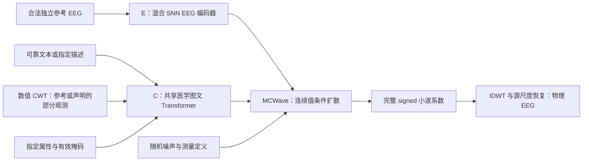

# SpikeWeave-EEG 项目总方案

更新：2026-10-08。状态：固定研究方案；v0.3 已实现双分支数据侧表、属性/局部观测控制和 G0–G2 开发评估入口；全量临床迁移、正式训练和真实效果仍待运行验证。

本文汇总目前确立的架构、数据、训练、评估和推进顺序。最新调整以本文及链接的专题协议为准；历史三分支原型不再作为主方案。

## 1. 目标、名称和范围

**SpikeWeave-EEG: Dual-Branch Spiking EEG and Vision–Language Alignment for Montage-Constrained Wavelet Diffusion**。

中文：脉冲脑电与图文对齐的导联约束小波扩散模型。生成模块名：**MCWave**。

目标：根据可靠医学语义、期望生理属性或合法局部结构条件生成 EEG，同时保持时频与跨通道测量结构，并提升真实患者的小样本检测/分类性能。

- 首版聚焦临床头皮 EEG，不加入 ImageNet 或视觉刺激任务。
- 长期目标是扩展跨患者、跨来源与医学任务的泛化；不能把首版固定导联和少量病理标签的结果称为“所有 EEG 泛化”。
- CHB-MIT 首版验证窗口内发作事件，不验证任意疾病诊断、真实报告理解或完整长时发作生成。
- 图像首先是 EEG 的数值 CWT 派生视图，并非独立采集的患者 CT/MRI。
- 数据增强的核心结果是锁定真实 query 上的收益，生成质量和控制是支持证据。

## 2. 研究来源和创新验证

| 来源 | 保留的思想 | 必须进一步证明的部分 |
|---|---|---|
| [Sketch2CT](https://openaccess.thecvf.com/content/CVPR2026/html/An_Sketch2CT_Multimodal_Diffusion_for_Structure-Aware_3D_Medical_Volume_Generation_CVPR_2026_paper.html) | 文本与局部结构引导、全局融合 | EEG 的局部结构条件如何校准并改善生成 |
| [MSADN](https://www.nature.com/articles/s41598-025-96185-2) | 小波、多尺度条件注入 | 完整 signed DWT 相比原波形生成的收益 |
| [JET](https://arxiv.org/abs/2605.21280) | clean 重建、统计与时空约束、类别不平衡处理 | 扩散改造、独立控制与真实增强是否优于强基线 |
| [WaveletDiff](https://github.com/GarlicWang/WaveletDiff) | 已有小波扩散与能量约束 | 不将 DWT diffusion 本身称为首次 |
| [STAtten](https://github.com/Intelligent-Computing-Lab-Panda/STAtten) | 脉冲空间—时间注意力 | EEG 适配是否优于同预算连续编码器 |
| [BiomedCLIP](https://huggingface.co/microsoft/BiomedCLIP-PubMedBERT_256-vit_base_patch16_224)、[ViLT](https://proceedings.mlr.press/v139/kim21k.html) | 医学预训练前端与共享图文 token 交互 | 是否优于获得同样条件的简单融合 |

模块组合和命名不构成已证实创新。SNN、共享融合、对比学习和全过程测量约束的必要性，留到完整评估阶段通过公平对照验证。ELM/CLEF 等已有 EEG—语言对齐工作仍需准确归属，参见 [related-work.md](related-work.md)。

## 3. 固定双分支与生成信息流

训练目标 EEG 和自身完整 CWT 用于重构与对比教师；在外部条件生成中，不作为生成器输入。可选 EEG 参考必须来自允许的源域/支持集。

两条顶层表征分支为 E 和 C。C(T,I)、C(T,null)、C(null,I) 共享参数；属性 token 并入 C。文本/视觉前端、两个投影读出及连续生成器不算新增顶层表征分支。

### 3.1 E：SNN EEG 编码器

| 参数 | 固定主配置 |
|---|---|
| 输入 | 16 导联 × 1024 点，256 Hz，4 秒 |
| 时间 patch | 每导联完整 16 点；64 个物理步，每步 62.5 ms |
| 主干 | 8 blocks，512 维，8 heads，FFN 2048 |
| 时空 chunk | 前 4 层为 4 步，后 4 层为 8 步 |
| 神经元 | Q/K/V、FFN 的 PLIF；ATan surrogate、detach reset |
| 膜态 | FP32；每条独立样本/reference 重置 |
| 读出 | 脉冲与膜电位联合读出；保留局部 token |
| 条件摘要 | 每导联 4 个时间摘要，合计 64 × 768 |
| 对比投影 | semantic/structure 各 512→1024→512，L2 normalize |
| 正则化 | 脉冲普通 dropout=0；连续读出 dropout=0.1；drop-path 0→0.1，全时间共享掩码 |

连续 EEG 直接入模型，不离线二值化为“真实神经元脉冲”。SNN 不预先声称 EEG 最优性或能耗优势。

### 3.2 C：共享图文条件分支

| 参数 | 固定主配置 |
|---|---|
| 文本前端 | BiomedCLIP 医学文本 Transformer，12 层/768 维/12 heads，256 tokens |
| 视觉前端 | BiomedCLIP ViT-B/16，12 层/768 维/12 heads |
| 数值视觉适配 | 每导联共享单通道 patch stem；加入真实 Hz/time、端点几何与有效 mask |
| 图像摘要 | 每导联 8 个摘要，合计 128 × 768 |
| 属性 | 最多 16 个 typed tokens，保存单位和有效性 |
| 联合主干 | 6 层/768 维/12 heads/FFN 3072，pre-norm、GELU |
| dropout | attention/FFN=0.1 |
| 输出 | 全局读出及局部条件 token；semantic/structure 各 768→1024→512 |

先适配数值 stem 与位置编码，再以小学习率解冻预训练高层。医学图文权重不等于原生 EEG 能力；权重必须是真实官方 checkpoint，禁止随机回退后称医学预训练。

### 3.3 固定对比与重构目标

- semantic：E↔C(T,I)，权重 1；E↔C(T,null)，权重 0.5。
- structure：E↔C(null,I)，权重 0.5。
- 温度初值 0.07；按实际有效项的权重和归一化。
- 使用 P/N/U 三值关系、多正例逐正例 log-softmax、双向平均、组等权。
- 只有至少一个 P 和一个 N 的 anchor 有效；任一方向全空时跳过该双向项并记录。
- 文本候选按规范语义组去重；不同图像实例保留；完全重复图文资产对去重。
- semantic P 要求可靠且作用范围一致；structure P 要求真实实例配对。相同类别不是结构等价。
- 重叠、同事件、同源复制或未核实近邻不得作为普通结构负例；未知关系归 U。

阶段 B：`L_alignment + 1.0 L_EEG_masked + 0.1 L_spectral`，时间 patch 遮挡率 40%。阶段 A 另外以权重 1 执行 40% 数值 CWT patch 重构。

完整损失及候选规则见 [contrastive-protocol.md](contrastive-protocol.md)。记录/患者级报告需要对应粒度聚合或 bag/MIL；当前实现尚未提供可验证的真实报告聚合路线。

### 3.4 MCWave 与约束

主配置：24 层/1024 维/16 heads/FFN 4096；XL 为 28 层/1152 维。连续 Transformer 处理扩散状态；SNN 处理 EEG 表征与合法参考。

设 montage 差分矩阵为 B，Q 为 col(B) 的正交基，W 为完整正交 DWT。硬模式定义 `Z0=Qᵀ X Wᵀ`，VP 路径为 `Zs=αs Z0+σs ε`，`αs²+σs²=1`。tokenizer 前先由 Q lift 到真实导联；head 返回 clean 系数后 reduce/lift，再 IDWT。默认 audit 模式保留完整测量空间，不静默删除真实残差。

采用 clean prediction：基本 MSE 权重 `min(SNR,5)`，辅助门控 `SNR/(1+SNR)`。

| 六类约束 | 内容 | 初始权重 |
|---|---|---|
| 重建 | 物理波形 L1/Laplace 残差 | 0.10 |
| 统计 | 全局与局部均值、标准差 | 均值/标准差各 0.05 |
| 动力学 | 全时间轴一阶差分匹配，含 patch 边界 | 0.05 |
| 时空 | 每导联 Pearson、跨导联相关矩阵 | 各 0.05 |
| 小波 | signed details、各层 log-energy | 各 0.05 |
| 控制 | 已提供且有效的局部结构/属性一致性 | 0.10 |

JET 原始 TV 单列对照，主方案使用差分匹配。独立参考 CWT 是条件，不是要求输出逐点复制的真值。部分观测控制只惩罚声明的可见且有效区域。

默认 `montage_mode=audit`。16 标准双极图的理想 rank=14 不等于所有实测窗口严格闭合；当前配置相对残差门槛 0.01 仅是待实测确认的工程阈值。启用 hard 前需要全体候选数据的绝对/相对残差审计及覆盖率，不能用一批通过替代整个数据集验收。

## 4. 双分支数据协议 v2

### 4.1 数据来源和作用范围

| 数据源 | 监督粒度 | 角色 |
|---|---|---|
| CHB-MIT | 窗口发作交集/事件时间 | 当前原型和来源内未见患者验证 |
| TUSZ | 事件起止、类型、通道 | 获准访问后的主要多类型队列 |
| TUEV | 标注病理/背景/伪迹片段 | 瞬态病理结构与困难负例 |
| TUEP | 患者级癫痫/非癫痫等 | 后续疾病条件与患者级聚合 |
| TUAB | 记录级正常/异常 | 后续记录级异常性评价 |
| Siena | 发作起止 | 保留作未参与开发的外部测试 |

先完成 CHB，再接入合法 TUSZ/TUEV；TUEP/TUAB 不广播为每窗诊断。TUH 目前不分发报告全文，模板只表达真实标注，不能伪造医生诊断或配对影像。TUH 子库可能共用母记录，先跨子库排重再分患者。CHB 非发作不等于健康；chb01/chb21 是同一患者。

### 4.2 物理处理和小波

- 复用经过校验的原 EDF、库存、split lock、导联映射与物理连续 shards；不因双分支重新下载/滤波。
- 导联为四条双极链的相邻差分：FP1–F7–T7–P7–O1、FP2–F8–T8–P8–O2、FP1–F3–C3–P3–O1、FP2–F4–C4–P4–O2。明确保存顺序和每条正负端点。
- 256 Hz、4 秒、1024 点、不重叠主窗口、float32 µV；保留事件交集、截断和不完整尾段记录。
- 沿用连续记录四阶 Butterworth 0.1–80 Hz 零相位滤波，必要时 `resample_poly`。保存源带宽；不默认同时去 50/60 Hz，不自动删除高幅病理瞬变。
- 先划分患者/允许时间块，再处理。支持/query 优先整记录隔离；同记录必须独立处理时间块，保护范围按滤波响应、重采样和小波支持审计。
- `source_rms_v2`：仅在有效 train/source 拟合 `s=sqrt(sum(x²)/N)`，模型波形为 `x/s`，不减均值。旧 affine 文件不直接用于新生成器。
- CWT：独立 4 秒窗、Morlet ω0=6、64 个对数频率 2–80 Hz、128 个时间格，先池化线性功率再 `ln(power+1e-12)`。模型视图在源 RMS 尺度上计算，绑定尺度指纹；不转 JPEG、不逐图 MinMax、不任意 resize 为 224×224。
- v0.3 完整有效格与视觉 patch 均要求全部贡献位置有效，使用 `cwt-all-contribution-v2` 掩码协议。数值核未变，仍保留 `triwave-morlet-v1`；旧 mask 不能仅改声明复用。
- 低频 COI 明确保存；4 秒的 2 Hz 完整核有效区域很小，不宣称整窗低频可靠，也不读取隐式邻窗上下文。低频属性另由波形估计。
- DWT：db4/J=3/periodization，A3/D3/D2/D1 signed 长度 128/128/256/512；在线计算，IDWT 数值验收。

### 4.3 资产角色和生成条件

| 角色 | 使用规则 |
|---|---|
| target_teacher | 目标完整 CWT；仅表征配对/教师和监督 |
| reference_condition | 独立 source/support CWT；条件/风格，不作为完整输出复制目标 |
| partial_observation | 明确开放的目标局部结构；仅观察协议，保存可见预算 |

局部观察协议在全部有效的 16×16 patches 中开放约 20%，记录舍入后的实际比例、mask 与随机种子。隐藏位置不能通过 token 或其他派生字段泄露。

参考库独立于 target 主索引。当前 v1 `ref_index` 优先匹配 target 真值标签：仅适用于明确给定类别的条件生成。v2 按请求条件或声明支持集检索；未知 query 不得读取隐藏标签选参考。

文本保存原标签、canonical namespace、scope、否定、时间范围、来源和模板版本。CHB 两类模板只描述“窗口含已标注发作/无已标注发作”。同义改写不算新增临床信息。

### 4.4 16 个数值属性

- 6 项：频谱质心、RMS、std、mean、平均相邻点绝对差、各导联峰绝对幅值的均值。
- 5 项比例和 5 项 log-energy：δ[0.5,4)、θ[4,8)、α[8,13)、β[13,30)、γ[30,80) Hz。
- 物理 µV 上逐导联计算，再在有效导联等权平均；频谱估计只为测量而去均值，采用 Hann rFFT，保留算法定义，不将所有能量称为校准 PSD 密度。
- 提取器与可微损失共用 `[0.5,80)` 和相同估计定义；当前 loss 的上端点口径需同步修改。
- 保存值、单位、有效范围、源带宽、算法版本与来源；不从属性推断没有标注的疾病。
- 分开 `teacher_attributes`、`condition_attributes`、`evaluation_attributes`。训练目标派生属性可作为明示源训练条件；部署/测试条件来自用户、合法参考或支持集。
- 非空条件样本 50% 不给属性；其余随机提供 1–4 个有效属性。全空 CFG 样本清除属性和参考。

### 4.5 落盘、体量和验收

新增 `processed/dualbranch-v2/`，引用合格 v1 物理 shards，保存：

| 文件 | 内容 |
|---|---|
| records.parquet | 文件/hash、患者/记录、split、处理范围、单位/导联/版本 |
| windows.parquet | offset/length、QC、事件交集、截断、source/support/query |
| texts.parquet | 文本、标签、语义组、scope、来源/模板 |
| views.parquet | 父窗口、teacher/reference/observation 角色、坐标、变换与 mask |
| attributes.parquet | 属性、单位、有效性、计算与来源 |
| relations.parquet | 配对与分组证据；batch 内动态 P/N/U，不存全局 N² |
| condition_specs.parquet | 请求条件、参考、可见预算、属性来源及实验类型 |

另保存 `train_scale_v2.json`、`montage_audit.json`、`dataset_audit_v2.json`。物理、尺度、条件策略分别指纹化，避免参考策略变化导致整库重新处理。

现有库存记录 raw 为 45,759,184,625 bytes（45.759 GB/42.617 GiB），不代表当前新增派生数据体量。一窗 waveform float32=64 KiB；CWT float32+逐元素 bool=640 KiB。100 万窗全缓存约 655.36 GB/610.35 GiB；首版不全量缓存 CWT，按需计算/限额缓存。16 float32 属性+16 bool 每窗约 80 bytes。

验收必须覆盖患者/事件/记录/上下文泄漏、单位和极性、尺度可逆、DWT 重建、CWT 坐标/有效性、真实 montage 残差、条件来源、QC 与事件保留数。工程闸门不能作为临床真实性证明。

详见 [data-protocol.md](data-protocol.md)、[dataset-chbmit-v1.md](dataset-chbmit-v1.md)。新侧表、严格 mask 和独立请求参考入口已有代码和工程测试；全量真实临床资产的完成状态需由实际构建报告确认。

## 5. 训练配置与资源

| 阶段 | 目标 | 新模块 LR | 预训练前端 | 有效 batch / weight decay |
|---|---|---|---|---|
| A | EEG 遮挡重构与数值视觉适配 | 1e-4 | 初始冻结 | 256 / 0.05 |
| B | 双分支固定对比与局部保真 | 1e-4 | 末两层解冻时 1e-5 | 256 / 0.05 |
| C | clean VP 与六约束 | 5e-5 | 初始冻结 E/C | 256 / 0.01 |

AdamW=(0.9,0.95)，bias/norm/神经元时间常数无 decay；warmup 5000 updates、cosine、clip=1、generator EMA=0.9999；BF16 矩阵运算、FP32 膜态。100000 updates 是正式起点，不是自动启动任务或必须耗尽的预算。开发先匹配预算做 pilot，按验证表现推进。

A/B 默认直接 batch 256；C microbatch 4、accumulation 64。优化器有效 batch 不能当作对比候选池：当前对比候选仍为实际 microbatch，改变它要记账。

图文40%、text40%、image10%、all-null10%；非空独立 reference 保留概率25%。属性缺失按 v2 数据配方执行。平衡训练按 source 标签计数/患者/事件组织；未标注有效源窗可作为单独无监督重构样本，不伪造负标签。验证/query 保持自然类别分布。

v0.3 CLI 对 v2 源训练库使用类别/患者/事件分层；合格未标注源窗可选进入表征重构。属性配方已接入 trainer。旧 v1/普通 manifest 接口仍保留原类别逆频率采样，不能将其视为相同实验。

主采样 Heun 50 积分区间、CFG 初值2；验证扫描1/1.5/2/3。当前实现50区间=101预测器调用，CFG2为202网络调用；公平比较记录真实 NFE 与耗时，不只列 steps。

本机：`/Users/shuxing/AIlearning/SpikeWeave-EEG`；legion：`/home/shuxing/workspace/SpikeWeave-EEG`。环境 `spikeweave-eeg`，下载工具 `spikeweave-download`。数据在 Git 外；本机开发→私有 GitHub→legion 拉取。当前显卡是工程过渡，不降低正式设计；付费长训练另行执行。

## 6. 分阶段评估：先达到强基线，再完整验证

**执行原则：未达强基线不运行完整消融、多数据库泛化、全面检索与成员攻击。保留必要的正确性和最低可信性检查。所有阶段闸门用开发/验证结果；最终 test 不参与筛选。**

G0的全索引检查主要核对划分与来源；数值检查先用代表性工程样本。全体真实montage残差审计是启用hard的前提：在audit模式pilot中不要求提前运行全套物理质量指标，不能以节省预算为由跳过硬模式所需验收。

| 阶段 | 运行内容 | 默认预算 | 下一阶段条件 |
|---|---|---|---|
| G0 正确性 | split/条件/单位/mask/IDWT/非有限/真实残差审计；短工程训练 | 小样本工程检查与必要全索引审计 | 无阻断性错误和条件泄漏 |
| G1 基线筛选 | 普通条件 VP、JET 与完整模型；小质量检查、一个 CNN 的真实开发增强 | 单训练种子；小固定审查库/自然分布开发子集 | 主开发指标达到最强已复现基线，同时最低质量检查通过 |
| G2 强基线复核 | 完整训练配置对最强基线的公平同预算比较 | 3 训练种子；仍只开发集，少量固定条件 | 主指标均值领先且至少2/3配对种子方向一致，无明显坍缩/复制/结构恶化 |
| G3 完整验证 | 固定测试、强基线全比较、机制消融、外部泛化、统计与成本 | 完整评估预算 | 完整证据支持后才声称测试范围内 SOTA |

G2 通过称“候选 SOTA/具备完整验证价值”，不提前声称已达到 SOTA。G3 失败需保留并报告；不得改回只展示 G1/G2 的最好结果，也不得反复用同一 test 调参。完整模型的两分支和六约束在低预算阶段不因此被默认删除。

G1/G2默认主闸门为strict source-only、自然分布开发query的患者等权AUPRC：先逐患者计算AP，再对预先定义的可计算患者等权平均。pooled AP和K=1 support为辅助，不事后择优晋级。无正类患者AP不定义，另报告覆盖与背景误报；主设置不可成立时，首轮运行前预注册唯一替代设置。G3沿用冻结的主设置与汇总口径。

### 6.1 G1：未达基线时的最小评估包

1. 每类合法验证审查库最多256窗；质量检查生成 `M=min(32,N合法)` 窗/类，固定抽相同数量真实窗，保留 real–real 参考。小样本 TS-FID/MMD 仅用于趋势诊断，不作论文显著性结论。
2. 检查物理 µV RMS/峰值、PSD、差分、相关与 montage 残差；少量同条件重复和训练最近邻。任何归一化/边界/复制错误先修复。
3. 有真实属性监督时，仅 RMS/频谱质心的源 P10/P50/P90，各8个配对噪声种子；没有属性监督则标记未验证，不能伪造控制成绩。
4. 一个固定 CNN，比较 real-only、重复/均衡、常规增强、JET、同信息普通 VP、完整模型的真实开发 AUPRC。用自然分布连续开发子集，不在两类等量的质量审查库上算主 AUPRC。
   起始real:synthetic=1:0.5，各生成方法固定同量；32个质量审查样本不等于完整下游增强数量。
5. source-only 与合法 K=1 support 分开；开发患者若不满足事件/记录独立条件，仅运行可成立的设置并注明。每次修改用同一固定开发样本和预算比较。
6. 不运行完整指标矩阵、所有 K、两个下游模型、所有消融和新来源。未达标继续定位表示、条件、目标/噪声权重、约束过强、尺度/边界或采样问题。

短训练或少量开发样本的失败不直接证明正式模型无效；G1只是预算匹配下的诊断趋势。增加训练预算或容量也由开发验证决定，不能用pilot结果声称正式SOTA。

### 6.2 G2：达到基线后的有限复核

固定候选配置、恢复完整主模型/训练预算，和最强已复现基线做3训练种子比较；公平匹配真实数据、条件、训练机会与采样成本，预训练成本单列。

主终点仍为真实开发 AUPRC；生成 TS-FID、最小控制、多样性/近邻和物理检查只做固定少量条件。最好单次种子领先不足以升级；均值及方向一致只是开发闸门，不是患者级统计显著性。

### 6.3 G3：候选 SOTA 时的完整评估包

**生成分布：** 作者 TS-FID、独立 source-only 波形 evaluator 特征 MMD、物理特征 Wasserstein、PSD/ACF/瞬态、跨导联关系、边界与测量残差。盲生成无唯一目标，不以随机配对的 MSE/PSNR 为主指标。TS-FID 定义见 [JET 附录](https://arxiv.org/html/2605.21280v1#A1.SS2)，不把独立神经网络特征距离也叫作者 TS-FID。

**控制：** 两个独立冻结 EEG 判别器，公布真实测试性能；改写、否定、scope、条件删除/打乱。RMS/频谱质心/δ占比的P10/P30/P50/P70/P90，各32个固定种子，报告MAE/IQR、单调性、非指定属性变化。联合属性限于可达组合；独立谱估计补检。部分观测可见区/隐藏区分开，不替代无目标观测成绩。

**表征：** 冻结 E 线性探针、语义组去重的文本匹配、双向 CWT 实例检索与困难候选。CHB两类文本不报告无意义的R@5；图像派生视图检索不能独证疾病理解。

**多样性与复制：** 独立特征 density/coverage、同条件变异、波形/频谱/特征最近邻、时间偏移复制、event/reference复制；必要时增加成员风险检查。噪声、相位随机化、坍缩和训练重放作为评估器反例。[PRDC 作者实现](https://github.com/clovaai/generative-evaluation-prdc)

**真实增强：** source-only 与 K=1/3/5 独立发作事件＋固定30分钟背景，记录实际时长/窗口/上下文；仅运行有独立剩余query的患者。两个下游模型（紧凑CNN、时序Transformer），相同数据/支持集/初始化/更新次数/调参预算。5组固定支持抽样、3训练种子；增强数量和比例验证选择。主AUPRC，辅助事件F1、灵敏度、误报/小时、检测延迟与AUROC。事件评分用固定版本 [SzCORE](https://epilepsybenchmarks.com/framework/) 并说明16双极测量配置；补零容差结果。零相位处理对应离线实验，不能宣称实时报警。

**完整基线：** real-only、重复/均衡、常规增强、原JET、WaveletDiff、同信息普通VP/DiT、小波＋简单FiLM、完整模型。JET原设置复现与公平预算改造分开，不将改造版冒充原始JET。TSTR仅作辅助。

**完整消融：** SNN对连续Transformer及无发放leaky-state；无对比及semantic/structure逐项去除；共享融合对同前端简单融合；raw/DWT；六约束逐组；自然/平衡采样；无测量约束/软closure/最终投影/全过程子空间。条件增减属于信息消融，与架构消融分开。

**泛化与统计：** 未见患者、未见来源、未见疾病分别定义。Siena固定为外部测试，不先适配后称source-only；使用无标签目标EEG需单列。所有结果逐患者报告、患者簇配对bootstrap，种子波动另记；4名CHB测试患者仅支持有限原型证据。不能用窗口/seed当新增患者。

**成本：** 训练GPU小时/峰值显存、生成速度、实际NFE、CFG额外调用、预训练/适配成本。研究范围内的SOTA须有公平基线、独立真实任务、控制/结构/多样性/复制及关键消融共同支持，不以一个最佳FID数字或开发结果命名。

完整细则见 [experiments.md](experiments.md)。

## 7. 实现状态与下一步

| 状态 | 内容 |
|---|---|
| 已实现并工程验证 | E/C、固定对比、signed DWT clean VP、六类约束、RMS、分阶段训练/累积/EMA；v0.3 数据/条件/开发评估与来源隔离测试 |
| 尚需准备/验证 | 官方完整 BiomedCLIP 权重、正式大模型显存与真实临床训练 |
| 已实现、临床资产待构建 | 七张侧表、物理16属性、严格CWT mask、独立请求参考bank、属性条件配方 |
| 控制入口已实现 | 独立参考与局部观测分离、partial-observation来源和可见预算；完整报告聚合仍未实现 |
| 开发评估已实现 | G0/G1轻量 evaluator、小 CNN 同预算下游、G2 三独立训练种子证据；G3 只登记操作，完整矩阵仍待研究阶段 |
| 当前结论 | 没有实测临床生成、SOTA、泛化或隐私保护结论 |

顺序：完成v2数据迁移与G0 → 单种子pilot和G1 → 未达基线就继续修问题 → 达强基线后G2 → 候选SOTA后G3。数据、训练和评估的实际状态必须由真实运行报告更新，不能把本文配方当已执行事实。

当前代码交付执行工程测试，不启动临床长训练、持续下载监控或付费资源。最新入口见 [implementation-v0.3.md](implementation-v0.3.md)，历史架构和测量记录见 [implementation-v0.2.md](implementation-v0.2.md)、[engineering-v0.2.md](engineering-v0.2.md)。
